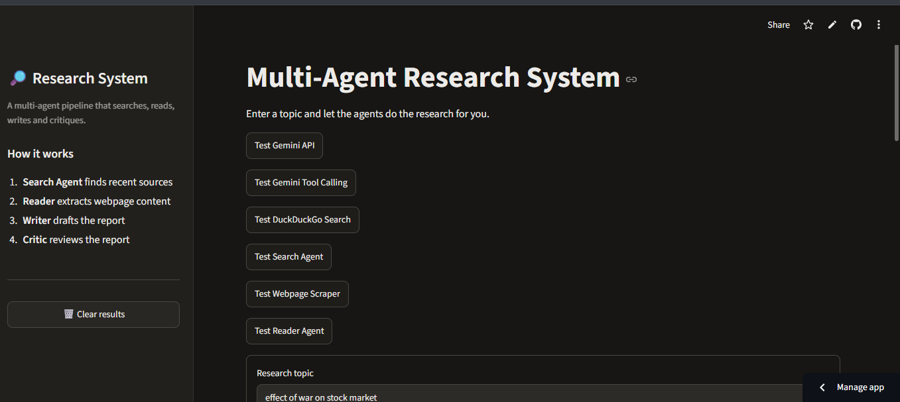
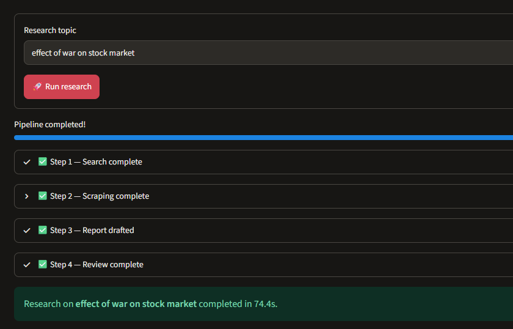
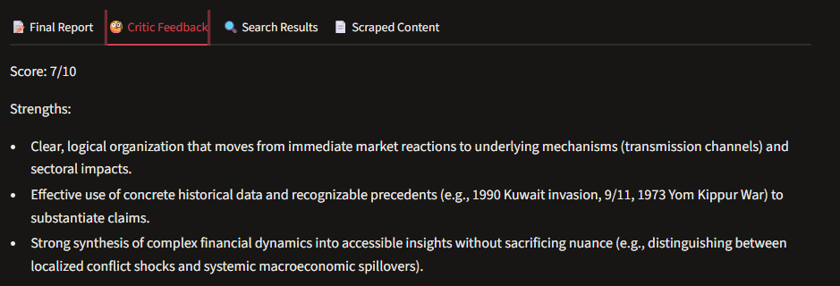

# 🤖 Multi-Agent Research System

An AI-powered research assistant that automates web research, extracts information from webpages, generates structured research reports, and evaluates the generated reports using AI.

Built with **Python, Streamlit, LangChain, LangGraph, and Google Gemini**, this project follows a four-stage research workflow: Search, Reader, Writer, and Critic.

🔗 **Live Demo:** [Multi-Agent Research System](https://multi-agent-research-system-r9b8z4h5dckuypztaeansx.streamlit.app/)

🔗 **GitHub Repository:** [AyeshaArif-10/multi-agent-research-system](https://github.com/AyeshaArif-10/multi-agent-research-system)

---

## 📸 Application Screenshots

### 1. Application Homepage



### 2. Research Workflow

The application displays the progress of all four stages and indicates when the pipeline completes successfully.



### 3. Generated Research Report

The Writer stage generates a structured research report based on the information collected during the research process.


### 4. Critic Feedback

The Critic evaluates the generated report and provides a score along with feedback about its strengths and areas for improvement.



---

## ✨ Key Features

- **Automated Web Search:** Retrieves relevant information using DuckDuckGo.
- **Webpage Scraping:** Extracts readable content from webpages using Requests and BeautifulSoup.
- **AI-Powered Report Generation:** Uses Google Gemini to generate structured research reports.
- **AI-Based Critic:** Evaluates the generated report and provides feedback.
- **Sequential Research Workflow:** Organizes the research process into four stages.
- **Error Handling and Retry Logic:** Handles temporary Gemini API availability issues through retry mechanisms.
- **Interactive Streamlit Interface:** Displays research progress and results.
- **Report Download:** Allows users to download generated reports.
- **Diagnostic Testing:** Includes individual test buttons for checking the Gemini API, tool calling, web search, search agent, webpage scraper, and reader agent.

---

## 🏗️ System Architecture

The application follows a sequential four-stage workflow.

```text
             USER INPUT
                  |
                  v
        +-------------------+
        |   SEARCH STAGE    |
        |                   |
        |   DuckDuckGo      |
        +-------------------+
                  |
                  v
        +-------------------+
        |   READER STAGE    |
        |                   |
        | Requests +        |
        | BeautifulSoup     |
        +-------------------+
                  |
                  v
        +-------------------+
        |   WRITER STAGE    |
        |                   |
        |   Google Gemini   |
        | Report Generation |
        +-------------------+
                  |
                  v
        +-------------------+
        |   CRITIC STAGE    |
        |                   |
        |   Google Gemini   |
        | Report Evaluation |
        +-------------------+
                  |
                  v
        +-------------------+
        |  RESEARCH OUTPUT  |
        +-------------------+
```

---

## ⚙️ How It Works

### 1. Search Stage 🔍

- Accepts a research topic from the user.
- Uses DuckDuckGo to search for relevant webpages.
- Collects titles, URLs, and descriptions from search results.
- Passes the collected information to the next stage.

### 2. Reader Stage 📄

- Extracts URLs from the search results.
- Uses Python Requests to retrieve webpage content.
- Uses BeautifulSoup to parse HTML.
- Removes unnecessary elements such as scripts, navigation bars, headers, and footers.
- Extracts readable webpage content for further processing.

### 3. Writer Stage ✍️

- Receives the research topic, search results, and scraped content.
- Uses Google Gemini to analyze the collected information.
- Generates a structured research report.
- Includes retry handling for temporary API availability failures.

### 4. Critic Stage 🧐

- Receives the generated research report.
- Uses Google Gemini to evaluate the report.
- Provides a score, strengths, and feedback.
- Displays the evaluation through the application interface.

---

## 🛠️ Technology Stack

| Technology | Purpose |
|---|---|
| Python | Core programming language |
| Streamlit | Interactive web application |
| LangChain | LLM integration and chains |
| LangGraph | Agent development and orchestration components |
| Google Gemini | AI-powered report generation and evaluation |
| DuckDuckGo Search | Web information retrieval |
| Requests | Fetching webpage content |
| BeautifulSoup | HTML parsing and text extraction |
| Python-dotenv | Environment variable management |

---

## 📂 Project Structure

```text
multi-agent-research-system/
│
├── app.py              # Streamlit application and research workflow
├── agents.py           # Gemini model, agents, writer and critic chains
├── tools.py            # Web search and webpage scraping tools
├── pipeline.py         # Research pipeline components
├── requirements.txt    # Project dependencies
├── screenshots/        # Application screenshots
│   ├── homepage.png
│   ├── workflow.png
│   ├── final_report.png
│   └── critic_feedback.png
├── .env                # API key configuration (not committed)
└── README.md           # Project documentation
```

---

## 🚀 Installation and Setup

Follow these steps to run the application locally.

### 1. Clone the Repository

```bash
git clone https://github.com/AyeshaArif-10/multi-agent-research-system.git
```

### 2. Navigate to the Project Directory

```bash
cd multi-agent-research-system
```

### 3. Create a Virtual Environment

```bash
python -m venv venv
```

Activate it:

**Windows:**

```bash
venv\Scripts\activate
```

**Mac/Linux:**

```bash
source venv/bin/activate
```

### 4. Install Dependencies

```bash
pip install -r requirements.txt
```

### 5. Configure the Gemini API Key

1. Visit [Google AI Studio](https://aistudio.google.com/).
2. Generate a Gemini API key.
3. Create a `.env` file in the project directory.
4. Add your API key:

```env
GOOGLE_API_KEY=your_gemini_api_key
```


### 6. Run the Application

```bash
streamlit run app.py
```

The application will open in your browser.

---

## 💡 Example Usage

1. Open the Multi-Agent Research System.
2. Enter a research topic.
3. Click the **Run Research** button.
4. Follow the progress of the four stages.
5. View the generated research report.
6. Explore the Critic Feedback, Search Results, and Scraped Content tabs.
7. Download the generated report.

**Example research topics:**

- Effect of War on Stock Markets
- Applications of Artificial Intelligence in Healthcare
- Impact of Generative AI on Education
- Recent Developments in Renewable Energy

---

## 🧪 Development and Testing

The application includes individual diagnostic buttons to test important components.

These tests help verify:

- Gemini API connectivity.
- Gemini tool calling.
- DuckDuckGo search functionality.
- Search Agent functionality.
- Webpage scraping.
- Reader Agent functionality.

This makes it easier to identify and troubleshoot issues in individual components.

---

## 🎯 Learning Outcomes

Through this project, I gained practical experience in:

- Understanding multi-agent AI workflows.
- Working with LangChain and LangGraph.
- Integrating Google Gemini with Python applications.
- Implementing web search and webpage scraping.
- Extracting and processing webpage content.
- Building LLM-powered report generation and evaluation chains.
- Handling API failures using retry mechanisms.
- Developing interactive applications using Streamlit.
- Deploying Python applications using Streamlit Community Cloud.

---

## 🔮 Future Improvements

- Implement source citations and reference tracking.
- Add a fact-checking stage to validate important claims.
- Improve report formatting and customization.
- Support PDF report generation.
- Add research history and session management.
- Explore more advanced agent orchestration strategies.

---

## 👩‍💻 Author

**Ayesha Arif**

B.Tech – Electronics and Communication Engineering

GitHub: [AyeshaArif-10](https://github.com/AyeshaArif-10)

---

⭐ If you find this project interesting, consider giving the repository a star!
